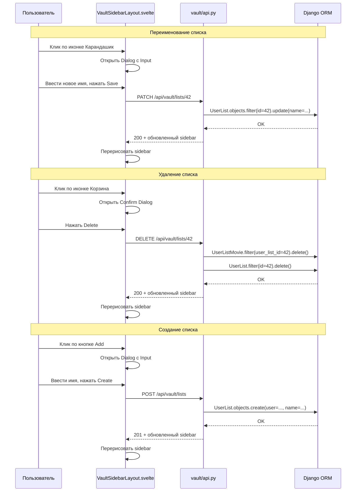
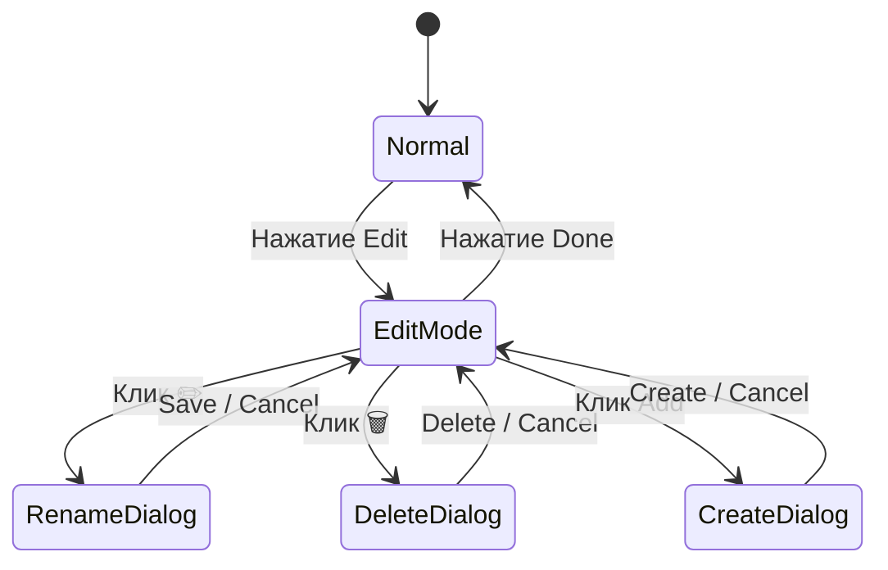

# CRUD пользовательских списков — План реализации

## Обзор фичи

Реализация CRUD-операций для пользовательских списков (создание, переименование, удаление) в сайдбаре нового Svelte frontend на странице `/vault` (корень).

**Существующее состояние:**
- Модели `UserList` и `UserListMovie` — [`vault/models.py`](vault/models.py:392)
- Legacy Django views (Create/Update/Delete) — [`vault/views.py`](vault/views.py:561)
- Ninja API: `GET /sidebar`, `POST /toggle-list` — [`vault/api.py`](vault/api.py)
- Sidebar layout — [`front/src/lib/components/VaultSidebarLayout.svelte`](front/src/lib/components/VaultSidebarLayout.svelte)
- shadcn-svelte компоненты: `dialog`, `input`, `button`, `sidebar` — **есть**
- shadcn-svelte `alert-dialog` — **нет**, нужно установить

## Архитектура



## Структура изменений

### Бэкенд — [`vault/api.py`](vault/api.py)

Новые эндпоинты в ninja API:

| Метод | URL | Описание | Request Schema | Response Schema |
|-------|-----|----------|----------------|-----------------|
| `POST` | `/lists` | Создание списка | `UserListCreateIn` | `UserListOut` |
| `PATCH` | `/lists/{list_id}` | Переименование | `UserListUpdateIn` | `UserListOut` |
| `DELETE` | `/lists/{list_id}` | Удаление списка | — | `UserListDeleteOut` |

**Новые Schemas:**

```
UserListCreateIn:
  name: str

UserListUpdateIn:
  name: str

UserListOut:
  id: int
  name: str

UserListDeleteOut:
  message: str
```

**Логика:**
- Все эндпоинты требуют аутентификации (`_require_api_user`)
- При удалении: сначала `UserListMovie.objects.filter(user_list=list).delete()`, затем `list.delete()`
- При переименовании: проверка что список принадлежит пользователю
- Slug пересчитывается автоматически через `save()` модели `UserList`

> **Примечание:** Модель `UserList` сейчас не имеет поля `slug`. Если slug нужен — потребуется миграция. Пока переименование работает через `name` без slug.

### Фронтенд — Svelte

#### 1. Установка `alert-dialog`

```bash
cd front && pnpm dlx shadcn-svelte@latest add alert-dialog
```

Компонент нужен для модального окна подтверждения удаления.

#### 2. Новые/изменённые файлы

| Файл | Действие | Описание |
|------|----------|----------|
| `front/src/lib/components/VaultSidebarLayout.svelte` | **Изменить** | Добавить режим Edit, кнопки, модалки |
| `front/src/lib/components/ListRenameDialog.svelte` | **Создать** | Модалка переименования |
| `front/src/lib/components/ListDeleteDialog.svelte` | **Создать** | Модалка подтверждения удаления |
| `front/src/lib/components/ListCreateDialog.svelte` | **Создать** | Модалка создания списка |
| `vault/api.py` | **Изменить** | Добавить 3 эндпоинта + schemas |

#### 3. Поведение `VaultSidebarLayout.svelte`

**Состояния:**
- `editMode: boolean` — включает/выключает режим редактирования
- `renameDialogOpen: boolean` + `listToRename: {id, name} | null`
- `deleteDialogOpen: boolean` + `listToDelete: {id, name} | null`
- `createDialogOpen: boolean`

**UI в режиме Edit:**
- Кнопка внизу сайдбара: `Edit` → `Done`
- У каждого custom list (id начинается с `list_`):
  - Маленькая иконка ✏️ (Pencil) → открывает ListRenameDialog
  - Маленькая иконка 🗑️ (Trash) → открывает ListDeleteDialog
- Кнопка `+ Add` рядом с `Done`

**UI в обычном режиме:**
- Только кнопка `Edit` внизу сайдбара

#### 4. Обновление sidebar данных

После каждого успешного API-вызова (create/rename/delete):
- Повторно запросить `GET /api/vault/sidebar`
- Обновить `sidebarItems` в layout

### Диаграмма состояний



## Порядок реализации

### Этап 1: Backend API

1. Добавить schemas `UserListCreateIn`, `UserListUpdateIn`, `UserListOut`, `UserListDeleteOut` в [`vault/api.py`](vault/api.py)
2. Добавить endpoint `POST /lists` — создание списка
3. Добавить endpoint `PATCH /lists/{list_id}` — переименование
4. Добавить endpoint `DELETE /lists/{list_id}` — удаление с очисткой `UserListMovie`

### Этап 2: Frontend — установка зависимостей

5. Установить `alert-dialog` через `pnpm dlx shadcn-svelte@latest add alert-dialog`

### Этап 3: Frontend — диалоги

6. Создать `ListRenameDialog.svelte` — модалка переименования
7. Создать `ListDeleteDialog.svelte` — модалка подтверждения удаления
8. Создать `ListCreateDialog.svelte` — модалка создания списка

### Этап 4: Frontend — sidebar

9. Модифицировать `VaultSidebarLayout.svelte`:
   - Добавить state для edit mode
   - Добавить кнопку Edit/Done в `Sidebar.Footer`
   - Добавить иконки действий для custom lists в edit mode
   - Добавить кнопку Add
   - Подключить диалоги
   - Реализовать обновление sidebar после мутаций

### Этап 5: Тестирование

10. Проверить все три операции (Create/Rename/Delete)
11. Проверить что удаление списка не удаляет фильмы
12. Проверить что системные списки не подлежат редактированию

## Решения (согласовано)

1. **Slug у `UserList` не нужен** — переименование работает через `name`, миграция не требуется.
2. **Кнопка Edit** — внизу сайдбара в `Sidebar.Footer`.
3. **Иконки** — Lucide (Pencil, Trash2, Plus).
4. **После удаления** — редирект на главную страницу Vault (`/`).
