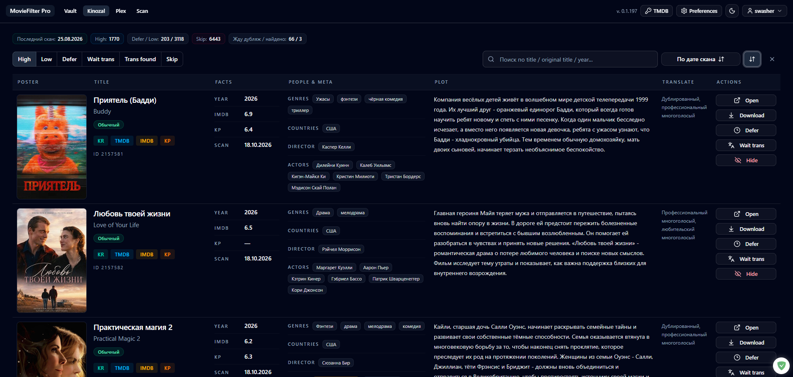
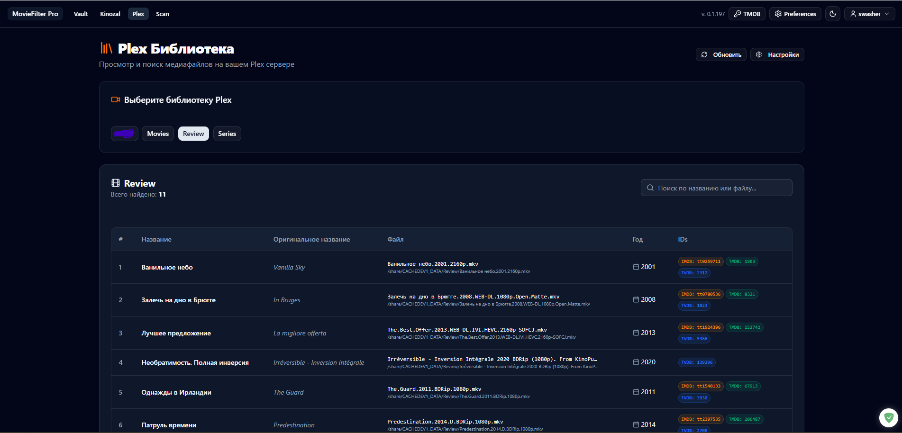
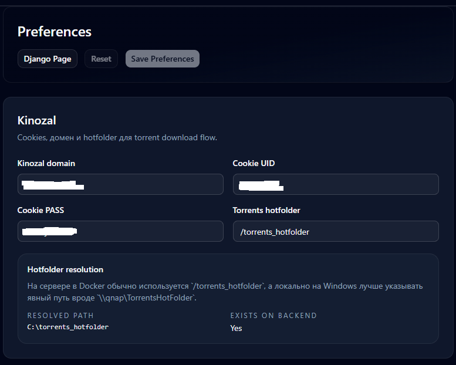
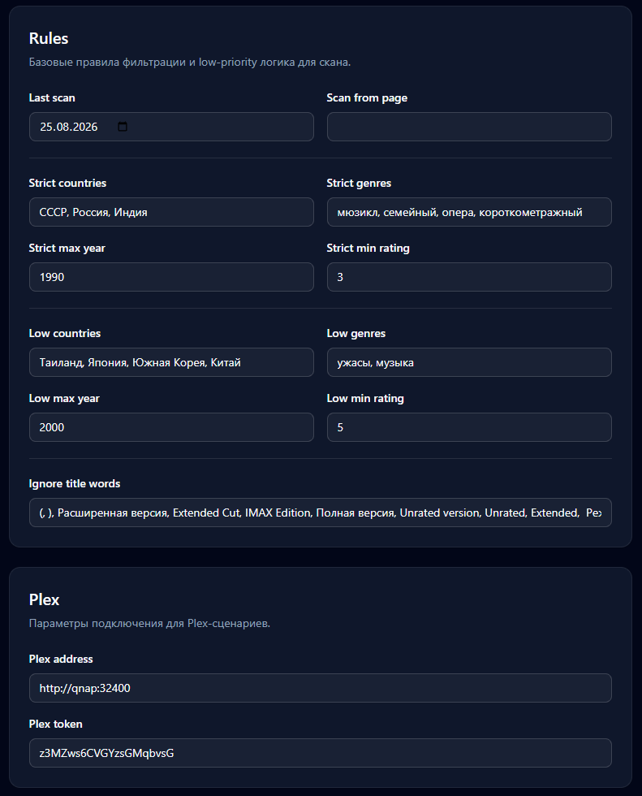
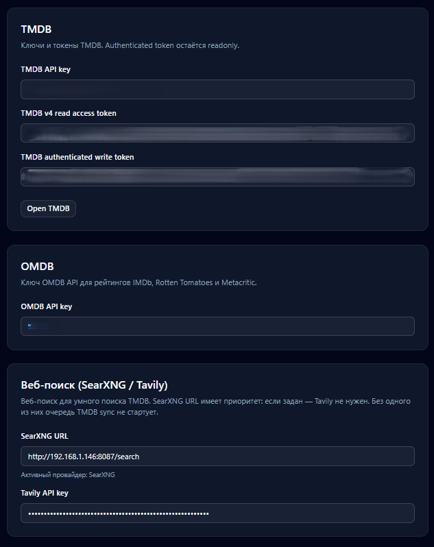
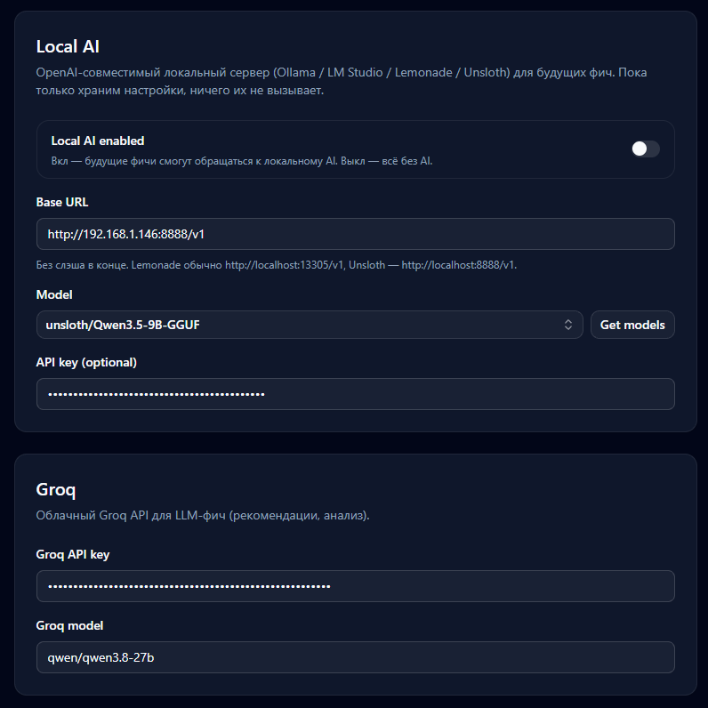
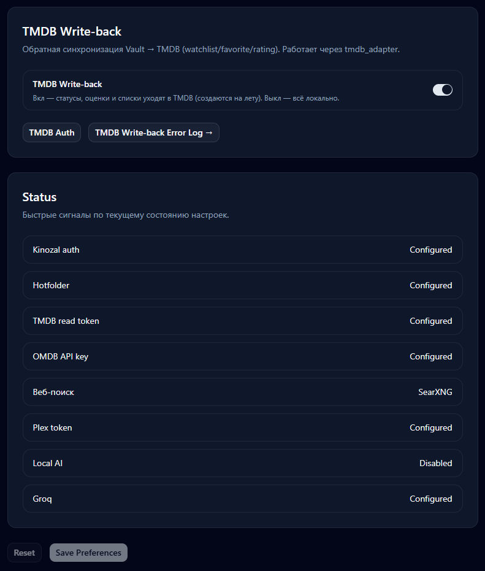

# MovieFilterPro

**Личная медиатека и помощник для поиска фильмов и сериалов.** MovieFilterPro объединяет ленту раздач Kinozal, умный сканер новых релизов, каталог Vault и медиатеку Plex в одном веб-приложении.

Приложение помогает находить интересные релизы, быстро оценивать совпадения с вашей коллекцией и управлять фильмами, сериалами, списками и статусами просмотра. Это self-hosted проект для одного пользователя: данные и подключение к внешним сервисам остаются под вашим контролем.

> **Статус проекта:** приложение развивается для личного использования. Возможности внешних интеграций зависят от настроек и доступности соответствующих сервисов.

## Основные возможности

- **Умная лента Kinozal.** Сортировка и фильтрация релизов по приоритетам, быстрый переход к информации о фильме и действия с раздачами.
- **Сканирование новинок.** Асинхронный сканер собирает релизы и применяет правила проверки, чтобы отбирать подходящие варианты.
- **Связь с Kinorium.** Локальный кэш Kinorium помогает сканеру сопоставлять релизы и пропускать уже известные записи.
- **Vault — личная фильмотека.** Каталог фильмов и сериалов, страницы деталей и персон, списки, избранное, заметки, оценки и статусы просмотра. Для сериалов предусмотрены сезоны и эпизоды.
- **Импорт Kinorium.** Перенос каталога, пользовательских статусов, оценок и списков из CSV-выгрузки Kinorium в Vault.
- **Умное сопоставление с TMDB.** Многоэтапный поиск соответствий для записей без внешних идентификаторов: названия и годы, поиск через SearXNG, AI-анализ и ручная проверка спорных кандидатов.
- **Vault ↔ TMDB.** Данные каталога обогащаются из TMDB, а ваши локальные статусы, оценки, избранное и пользовательские списки можно отправлять обратно в TMDB.
- **Plex.** Просмотр и поиск медиаматериалов в подключённых библиотеках Plex.
- **Единый веб-интерфейс.** Современный frontend на Svelte 5 работает с backend API на Django и django-ninja.

## Скриншоты

Добавьте изображения в `docs/screenshots/` и замените пути ниже на имена файлов. До появления изображений блоки оставлены как напоминания.

### Vault — главная страница и коллекция


### Лента Kinozal



### Сканирование релизов

<!-- TODO: добавить скриншот страницы сканирования: docs/screenshots/scan.png -->

> Место для скриншота: `docs/screenshots/scan.png`

### Plex



### Настройки интеграций







## Разделы приложения

| Раздел | Назначение |
| --- | --- |
| **Vault** | Каталог, поиск и детали фильмов и сериалов, персоны, списки и статусы просмотра |
| **Kinozal** | Лента релизов, фильтры, приоритеты и действия с раздачами |
| **Scan** | Запуск и отслеживание сканирования новых релизов |
| **Plex** | Поиск и просмотр содержимого медиасервера |
| **TMDB Sync** | Сопоставление и синхронизация записей с TMDB |
| **Preferences** | Настройки подключений и внешних сервисов |

## Импорт списков Kinorium в Vault

MovieFilterPro умеет импортировать выгрузку Kinorium в личную библиотеку Vault. Команда `import_kinorium_csv` читает CSV-файлы из `vault/current_csv/`, создаёт записи каталога и переносит пользовательские данные: статусы просмотра, оценки, избранное, персоны и пользовательские списки. Импорт рассчитан на пустые таблицы Vault; его запуск описан в разделе [импорта исходного каталога](#импорт-исходного-каталога-kinorium).

Это перенос данных из экспорта в локальную базу. Сам по себе он не требует внешних идентификаторов TMDB и не выполняет поиск соответствий во внешнем каталоге.

## Сопоставление записей Vault с TMDB

У Kinorium нет внешних идентификаторов TMDB, IMDb и других каталогов, по которым можно было бы однозначно связать каждую запись. Одного поиска по названию недостаточно: названия переводятся по-разному, годы могут расходиться, а у разных произведений бывают одинаковые названия. Поэтому импортированный список не связывается с TMDB одним неточным запросом — каждую запись проходит многоступенчатый конвейер проверки.

В общих чертах он работает так:

1. **Импорт исходных данных.** Команда `import_kinorium_csv` создаёт локальные записи каталога из CSV Kinorium. Сохраняются доступные исходные сведения, включая названия, год, описание и данные об участниках.
2. **Поиск кандидатов.** Сначала приложение ищет в TMDB по названиям и их вариантам, отдельно учитывая фильмы и сериалы. Кандидаты оцениваются по совпадению локального и оригинального названия, альтернативных названий, года и типа произведения.
3. **Расширение поиска.** Если стандартного поиска TMDB недостаточно, умный поиск использует веб-контекст: запросы формируются по названиям и фрагменту сюжета, а SearXNG (или Tavily, если SearXNG не настроен) помогает найти дополнительные сведения. Затем поиск повторяется в TMDB на русском и английском языках.
4. **Проверка похожих вариантов.** Алгоритм сопоставляет варианты названий, даты и описания; при необходимости AI сравнивает сюжет и актёрский состав. Для спорных случаев предусмотрены отдельные проверки уверенности, чтобы не принимать похожее название за правильный фильм.
5. **Подтверждение неоднозначных совпадений.** Если уверенного победителя нет, приложение показывает кандидатов для выбора или подтверждения. После определения записи сохраняется TMDB ID — дальше он служит устойчивой связью для синхронизации данных.

Если пользовательский список из импортированного каталога предназначен для TMDB, его элементы сначала должны получить TMDB ID через сопоставление записей Vault. Затем, если включён write-back списков, MovieFilterPro создаёт соответствующий TMDB List и передаёт в него разрешённые элементы. Связь устанавливается по каждому фильму отдельно, а неоднозначные или не найденные элементы можно разбирать независимо.

Такой подход позволяет разбирать списки, где нет внешних ID, и снижает риск ошибочных привязок. Автоматическое сопоставление зависит от полноты исходных названий, года, описания и актёрских данных; часть записей может потребовать ручного выбора. Для умного поиска настройте SearXNG URL либо Tavily API key в Preferences. Доступность AI-этапов зависит от соответствующих AI-настроек приложения.

## Локальные оценки и статусы пользователя в TMDB

Vault хранит ваши пользовательские данные локально, но при включённой авторизации TMDB может также поддерживать их копию в вашем аккаунте TMDB. Изменение оценки, статуса, избранного или состава списка в Vault автоматически ставится в фоновую очередь на отправку. Интерфейс не ждёт ответа TMDB, а результат и ошибки синхронизации можно проверить в разделе TMDB Write-back.

Поддерживается следующий маппинг:

| Vault | TMDB |
| --- | --- |
| Статус **«Запланировано»** | Watchlist |
| Статус **«Просмотрено»** | Отдельный зеркальный список «Просмотрено» |
| Статус **«Не интересует»** | Отдельный зеркальный список «Не интересует» |
| Избранное | Favorites |
| Оценка от 1 до 10 | Оценка TMDB |
| Пользовательские списки | TMDB Lists: состав, создание, переименование и удаление |

У TMDB нет отдельного статуса «Просмотрено», поэтому MovieFilterPro сохраняет его в специальном зеркальном списке. Так на внешнем аккаунте остаётся след о просмотре даже для фильма без оценки. Передача выполняется асинхронно; повторные быстрые изменения объединяются, а ошибки помещаются в очередь повторных попыток и доступны для просмотра.

Чтобы включить write-back, укажите TMDB API credentials, пройдите **TMDB Auth** для получения авторизованного write token и включите обратную синхронизацию и синхронизацию списков в Preferences. Для сериалов синхронизируются данные фильма/сериала и пользовательские статусы верхнего уровня; статусы отдельных сезонов и эпизодов в TMDB не передаются.

TMDB в этом сценарии служит внешней копией и точкой доступа к вашим отметкам через аккаунт TMDB. Она не заменяет локальный Vault: направление пользовательской синхронизации — **Vault → TMDB**, поэтому изменения, сделанные непосредственно на TMDB, автоматически обратно в Vault не импортируются.

## Технологии

- **Backend:** Python 3.12+, Django, Django Ninja, Huey, Channels.
- **Frontend:** Svelte 5, SvelteKit, TypeScript, Tailwind CSS и shadcn-svelte.
- **База данных:** PostgreSQL для приложения; Huey также поддерживает отдельное хранилище состояния очереди.
- **Интеграции:** Kinozal, Kinorium, TMDB и Plex; веб-поиск для задач TMDB настраивается через SearXNG или Tavily.
- **Развёртывание:** Docker-образ собирает frontend и запускает веб-приложение вместе с фоновым worker-процессом.

## Настройка интеграций

Системные параметры Django, секретный ключ и подключение к базе задаются через переменные окружения. Для локальной разработки используйте `.env.example` как ориентир и создайте собственный `.env`.

Ключи API, адреса сервисов и пользовательские данные подключения задаются на странице **Preferences** самого приложения. Это относится к TMDB, Plex, Kinozal, SearXNG и Tavily. Не добавляйте эти значения в общий `.env` или README.

Для авторизованной обратной синхронизации Vault → TMDB требуется отдельно пройти настройку TMDB Auth. Архитектура этого потока описана в [`docs/WRITEBACK_IMPLEMENTATION.md`](docs/WRITEBACK_IMPLEMENTATION.md).

## Запуск и разработка

Для работы из исходного кода нужны Python 3.12+, [`uv`](https://docs.astral.sh/uv/), Node.js и pnpm.

```powershell
# Установить Python-зависимости
uv sync

# Подготовить локальный .env на основе примера и заполнить системные параметры
Copy-Item .env.example .env

# Применить миграции
uv run python manage.py migrate

# Установить зависимости frontend
Set-Location front
pnpm install

# Запустить frontend в режиме разработки
pnpm dev
```

Frontend разработки и Django запускаются отдельно. Для production-сборки frontend используйте `pnpm build` в каталоге `front`; Dockerfile собирает frontend и включает его в runtime-образ. Перед публикацией настройте системные переменные окружения, хранилище PostgreSQL и Preferences в приложении.

## Импорт исходного каталога Kinorium

Импорт CSV в Vault рассчитан на пустые таблицы Vault. В каталоге `vault/current_csv/` должен находиться исходный CSV-файл:

```powershell
uv run python manage.py import_kinorium_csv
```

Команда импорта создаёт записи фильмотеки и связывает сущности. Перед запуском ознакомьтесь с используемым CSV и текущей конфигурацией базы данных.

## Структура проекта

```text
core/             Общая инфраструктура и API
front/            SvelteKit frontend
kinozal_scan/     Сканирование и разбор релизов Kinozal
kinorium/         Интеграция и данные Kinorium
moviefilter/      Лента Kinozal и пользовательские предпочтения
plex/             Интеграция с Plex
tmdb_adapter/     Инфраструктурный клиент TMDB
vault/            Модели, API и сервисы личной фильмотеки
web_logger/       Логи и realtime-канал
docs/             Документация и архитектурные заметки
```

## Документация

- [Архитектура обратной синхронизации Vault → TMDB](docs/WRITEBACK_IMPLEMENTATION.md)
- [Логирование](docs/LOGGING.md)
- [WebSocket-логирование](docs/WEBSOCKET-LOGGING.md)

## Безопасность и данные

MovieFilterPro рассчитан на личный self-hosted сценарий. Аутентификация приложения остаётся включённой. Храните `.env`, токены и ключи интеграций вне системы контроля версий и предоставляйте приложению только необходимые доступы.

Инструменты импорта и очистки данных Vault предназначены для конкретных сценариев работы с локальным каталогом. Перед запуском команд управления данными убедитесь, что выбран нужный экземпляр базы данных.

## В разработке

### Развитие интеграции с Plex

В приложении уже есть страница подключённой Plex-библиотеки: можно просматривать и искать медиа на сервере. Интеграция продолжает развиваться; текущая страница и подключение настраиваются через Preferences.

### Интеграция с qBittorrent

Планируется связать фильмы и сериалы Vault с раздачами в qBittorrent через API. В плане — показывать на карточке, есть ли торрент в клиенте, скачивается ли он или отсутствует; для активной загрузки отображать прогресс, скорость и примерное оставшееся время. Для сериалов предполагается включать последовательную загрузку. Добавление раздач через API должно связывать торрент с записью Vault тегом, а при переводе фильма в статус «Просмотрено» приложение сможет предложить удалить торрент.

Способ обновления прогресса ещё предстоит выбрать: периодические запросы со страницы либо потоковое обновление через WebSocket или SSE. Это планируемые возможности, а не описание уже готовой интеграции. Подробности и технические заметки находятся в [`PLANS-qbittorrent-integrations.md`](PLANS-qbittorrent-integrations.md).
